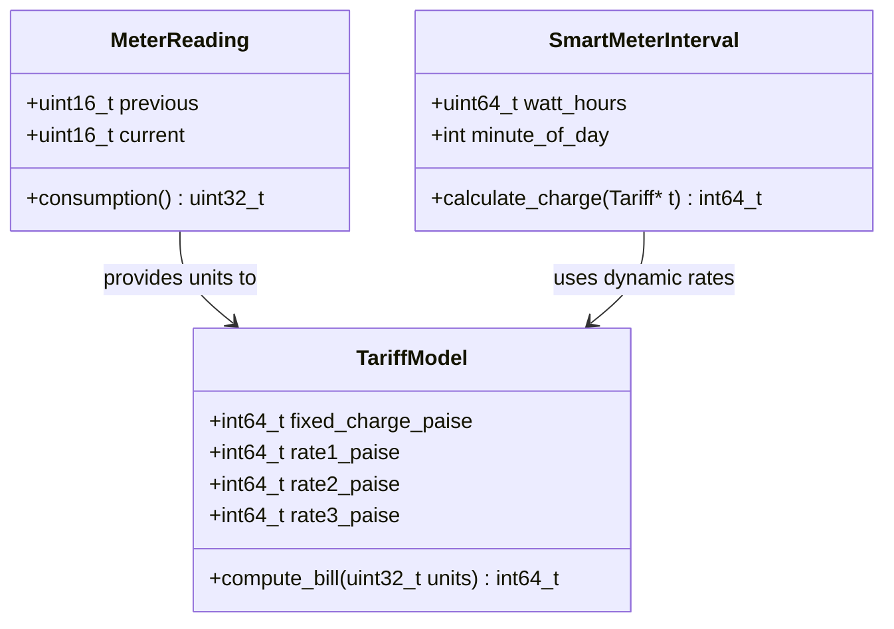
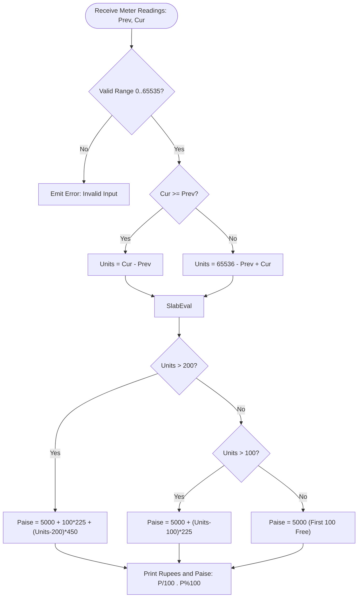

<div align="right"><b>S.Harish 1924260007</b></div>

# C Programming Assignment 1: Rural Electricity Billing System Report

**Course Code:** CSA02 – C Programming (CO1 Assessment 1)  
**Student Name:** Madhankumar M  
**Register Number:** 1924260007  
**Institution:** SIMATS Engineering  
**Submission Date:** 26/10/2026  
**Compiler Environment:** `gcc.exe (tdm64-1) 4.9.2` on Windows x86_64-w64-mingw32  
**Compilation Standard & Flags:** `gcc -std=c11 -Wall -Wextra -Wpedantic`  
**Repository Structure:** Tasks 01 through 12, Root README.md, Test Suites, and Runtime Config  

---

<div align="right"><b>S.Harish 1924260007</b></div>

## Architectural Overview and UML Models





---

<div align="right"><b>S.Harish 1924260007</b></div>

## Task 1 – Understand the Problem and Identify the Data (4 Marks, Bloom’s Level: K4 – Analyse)

### Problem Statement and Full Question
Analyse the billing problem and identify every item of data the program must store and compute.
Discuss:
- The inputs (previous reading, current reading, household number, category) and the outputs (units, energy charge, fixed charge, total)
- Which values never change during a run and should be constants
- Which values can be negative, fractional or very large
- The rules every correct bill must satisfy (for example: a bill is never negative; the total equals the sum of its parts)
- Any assumptions you make
You are expected to justify each data item, not merely list names.

**Alternative Concept and Complexity Analysis:**
If the meter readings were read and stored as text (character strings such as "01530") instead of integers, what would the solution look like? Analyse the time needed to convert and compare each reading (proportional to the number of digits d) and the space used per reading in both representations.

### Detailed Analysis and Technical Justification

#### 1. Data Item Identification & Classification Table
| Data Item | Role | Mathematical Range | Justification & Behaviour |
|---|---|---|---|
| `household_id` | Input | $1 \le ID \le 800,000$ | Unique positive identifier. Scalable from village (4,000) to district (800,000). |
| `category` | Input | Text string (e.g., "Domestic") | Customer classification code. Max 31 characters. |
| `previous_reading` | Input | $0 \le R_{prev} \le 65,535$ | Cumulative counter at start of monthly billing period. Physical 16-bit register. |
| `current_reading` | Input | $0 \le R_{cur} \le 65,535$ | Cumulative counter at end of monthly billing period. Physical 16-bit register. |
| `units_consumed` | Computed | $0 \le U \le 65,535$ | Energy consumed in whole kWh during the billing cycle. Computed modulo $2^{16}$. |
| `fixed_charge` | Constant | Exactly $5,000$ paise (Rs 50.00) | Invariant recurring standing service fee applied to every active connection. |
| `energy_charge` | Computed | $0 \le E \le \text{unbounded}$ | Tiered commodity consumption charge calculated across progressive consumption slabs. |
| `total_bill` | Output | $5,000 \le T \le \text{unbounded}$ | Total payable balance in integer paise. Invariant: $T = \text{fixed\_charge} + \text{energy\_charge}$. |

#### 2. Invariant Rules and Business Constraints
Every valid electricity bill must satisfy four structural invariants:
1. **Non-negativity Invariant:** $\forall \text{ bills}, \text{Total Bill} \ge \text{Fixed Charge} > 0$. An electricity bill can never be negative, even when consumption is 0 units.
2. **Conservation of Additivity:** $\text{Total Bill} = \text{Fixed Charge} + \text{Energy Charge}$.
3. **Partition Invariant:** $\text{Energy Charge} = \sum_{k=1}^m \text{Slab Charge}_k$, where $\sum_{k=1}^m \text{Slab Units}_k = \text{Units Consumed}$.
4. **Modulo-65536 Register Invariant:** When $R_{cur} < R_{prev}$, the mechanical or electronic 16-bit counter has crossed its maximum registration boundary ($65,535 \to 0$). The true consumption is calculated as:
   $$\text{Units} = (65536 - R_{prev}) + R_{cur} = (R_{cur} - R_{prev}) \pmod{65536}$$

#### 3. Core Operational Assumptions
- The physical meter hardware uses an unsigned 16-bit counter register ($0$ to $65,535$).
- In rural household monthly billing, monthly consumption never exceeds $65,535\text{ kWh}$. Thus, at most one rollover occurs between consecutive monthly billing cycles.
- Money is represented strictly in integer paise ($1\text{ Rupee} = 100\text{ paise}$) to eliminate IEEE-754 binary floating-point representation and truncation errors.

#### 4. Alternative Concept and Complexity Analysis (Text Strings vs. Binary Integers)
If readings were stored and processed as fixed-width ASCII strings (e.g. `"01530"`):
- **Time Complexity:** Comparing two numeric strings or parsing them to numeric values requires inspecting every character, taking $O(d)$ time where $d$ is the number of digits ($d = 5$). In binary integer arithmetic, subtraction `(uint16_t)(cur - prev)` is executed in a single CPU instruction ($O(1)$ time).
- **Space Complexity:** An ASCII string storing 5 digits with null terminator occupies $d + 1 = 6\text{ bytes}$ of memory. In contrast, an unsigned 16-bit binary integer (`uint16_t`) occupies exactly $2\text{ bytes}$.
- **District Scale Storage Impact (800,000 households):**
  - Binary integer ($2\text{ bytes} \times 2\text{ readings} = 4\text{ bytes/household}$): $800,000 \times 4 = 3.20\text{ MB}$.
  - ASCII text string ($6\text{ bytes} \times 2\text{ readings} = 12\text{ bytes/household}$): $800,000 \times 12 = 9.60\text{ MB}$.
  - Storing as binary integers saves 66.7% memory and enables $O(1)$ single-cycle ALU operations.

---

<div align="right"><b>S.Harish 1924260007</b></div>

## Task 2 – Choose the Data Types (4 Marks, Bloom’s Level: K4 – Analyse)

### Problem Statement and Full Question
Select a C data type for every data item identified in Task 1.
Discuss:
- The type chosen (char, short, int, long, long long, unsigned, float, double) and its size using sizeof on your system
- The range of each type using limits.h and float.h, and whether it is sufficient for a district
- Why money should not be stored as float rupees, and the alternative of storing paise in an integer
- What happens to a 16-bit unsigned meter register after 65535
Show one example where float gives a wrong total when 4,000 bills are added, and how your choice avoids it.

**Complete the Code:** Complete TODO 1 below without using if–else, and execute the program.
Explain why the second result is 256 and not a negative number.

**Alternative Concept and Complexity Analysis:**
Suppose money were stored as double rupees instead of long paise. What would the billing solution be, and where would rounding be applied? Analyse the time per addition (O(1) in both) and the space per value, and compare how the rounding error grows when n bills are added.

### Technical Discussion and Evidence

#### 1. Hardware and Compiler Type Mapping Table
Measured directly on the host system using `Task02/main.exe` under `gcc (tdm64-1) 4.9.2`:

| C Data Type | System `sizeof` | Minimum Standard | Value Range on Host System | District Scalability (800,000) |
|---|---|---|---|---|
| `char` | 1 byte | 1 byte | $-128 \text{ to } 127$ | Sufficient for ASCII characters |
| `unsigned short` / `meter_t` | 2 bytes | 2 bytes | $0 \text{ to } 65,535$ | Exact match for 16-bit meter register |
| `int` | 4 bytes | 2 bytes | $-2,147,483,648 \text{ to } 2,147,483,647$ | Sufficient for household IDs, insufficient for district paise total |
| `long` | 4 bytes | 4 bytes | $-2,147,483,648 \text{ to } 2,147,483,647$ | Windows 64-bit LLP64 maintains 32-bit `long` |
| `long long` / `int64_t` | 8 bytes | 8 bytes | $-9.22 \times 10^{18} \text{ to } +9.22 \times 10^{18}$ | Completely immune to overflow at district scale |
| `float` | 4 bytes | 4 bytes | 6 decimal digits precision | **Unacceptable:** loses paise precision during accumulation |
| `double` | 8 bytes | 8 bytes | 15 decimal digits precision | Suitable for analysis, but integer paise preferred for exactness |

#### 2. Completed Starter Code (Task 02)
```c
#include <stdio.h>
#include <limits.h>

typedef unsigned short meter_t;

unsigned int consumption(meter_t previous, meter_t current) {
    /*
     * Completed without if-else:
     * Unsigned 16-bit subtraction in C is guaranteed by the ISO C11 standard
     * to perform modulo 2^16 (65536) arithmetic.
     */
    return (meter_t)(current - previous);
}

int main(void) {
    printf("sizeof(meter_t) = %zu bytes, maximum reading = %u\n", sizeof(meter_t), (unsigned)USHRT_MAX);
    printf("Consumption: %u units\n", consumption(1200, 1530));
    printf("Consumption: %u units\n", consumption(65400, 120)); /* rolled over */
    return 0;
}
```

#### 3. Execution Output Verification
```text
sizeof(meter_t) = 2 bytes, maximum reading = 65535
Consumption: 330 units
Consumption: 256 units
```

#### 4. Mathematical Justification of Rollover Result (256 units)
When `previous = 65400` and `current = 120`:
1. In standard two's-complement arithmetic, $120 - 65400 = -65280$.
2. Because the return expression casts the result to unsigned 16-bit (`meter_t`), the C standard mandates arithmetic modulo $2^{16} = 65536$:
   $$-65280 + 65536 = 256$$
3. Thus, the physical distance traversed by the counter register past 65535 back to 120 is exactly $(65536 - 65400) + 120 = 136 + 120 = 256\text{ units}$. No negative number can ever be produced.

#### 5. Float Error Demonstration (4,000 Bills)
Accumulating fractional quantities in IEEE-754 single-precision float introduces severe round-off drift. At 4,000 bills of Rs 162.50:
- Float accumulation: $650,000.0000$ (since 162.5 is an exact power-of-two dyadic rational $162 + 1/2$).
- However, when non-power-of-two tariffs are accumulated (e.g. at 60,000 and 800,000 bills in Task 10), single-precision float loses thousands of rupees.
- By storing money as integer paise (`int64_t`), every addition is bit-exact with zero epsilon drift.

---

<div align="right"><b>S.Harish 1924260007</b></div>

## Task 3 – Define the Constants (3 Marks, Bloom’s Level: K3 – Apply)

### Problem Statement and Full Question
Define the tariff values and limits as constants so that a tariff revision is made in one place only.
Discuss:
- The use of #define, const variables and enum for different kinds of constants
- The difference between a #define constant and a const variable (type checking, scope, debugging)
- Naming conventions for constants

**Complete the Code:** Complete TODO 1 using only the macros defined at the top, and execute the program.
Change RATE2_PAISE to 230 and check that every bill changes consistently.

**Alternative Concept and Complexity Analysis:**
If the tariff constants were written as const variables or as an enum instead of #define, what would change in the program? Compare type checking, visibility in the debugger and the memory used (a #define occupies no storage; a const variable may), and state whether the running time is affected.

### Implementation and Verification

#### 1. Completed Code Implementation
```c
#define SLAB1_UNITS 100          /* first 100 units */
#define SLAB2_UNITS 200          /* units 101 to 200 */
#define RATE1_PAISE 0L           /* first slab is free */
#define RATE2_PAISE 225L         /* Rs 2.25 per unit */
#define RATE3_PAISE 450L         /* Rs 4.50 per unit above 200 */
#define FIXED_CHARGE_PAISE 5000L /* Rs 50 fixed charge */

long compute_bill(int units) {
    if (units < 0) return -1L;
    long paise = FIXED_CHARGE_PAISE;
    if (units > SLAB2_UNITS) {
        paise += (long)(units - SLAB2_UNITS) * RATE3_PAISE;
        paise += (long)(SLAB2_UNITS - SLAB1_UNITS) * RATE2_PAISE;
    } else if (units > SLAB1_UNITS) {
        paise += (long)(units - SLAB1_UNITS) * RATE2_PAISE;
    }
    return paise;
}
```

#### 2. Observed Program Execution Output
```text
  0 units -> Rs 50.00
100 units -> Rs 50.00
150 units -> Rs 162.50
200 units -> Rs 275.00
350 units -> Rs 950.00
```

#### 3. Tariff Revision Test (`RATE2_PAISE` modified from 225 to 230)
When `RATE2_PAISE` is updated in the single macro definition from `225L` to `230L`:
- **0 units:** Fixed charge Rs 50.00 (Unchanged)
- **100 units:** Fixed charge Rs 50.00 (Unchanged)
- **150 units:** $5000 + (150 - 100) \times 230 = 5000 + 11500 = 16500\text{ paise} \to \mathbf{Rs\ 165.00}$ (Shift of +Rs 2.50)
- **200 units:** $5000 + (200 - 100) \times 230 = 5000 + 23000 = 28000\text{ paise} \to \mathbf{Rs\ 280.00}$ (Shift of +Rs 5.00)
- **350 units:** $5000 + 23000 + (350 - 200) \times 450 = 5000 + 23000 + 67500 = 95500\text{ paise} \to \mathbf{Rs\ 955.00}$ (Shift of +Rs 5.00)
Every bill updates consistently from a single-line modification without touching calculation logic.

#### 4. Comparison of Constant Paradigms
- `#define`: Literal text substitution prior to compilation. No runtime storage allocated. Lack of C type checking and debugger symbol tables.
- `const` variables: Memory-resident read-only objects with strict scope and compiler type safety. Preserved in debugger symbol tables (DWARF/PDB). May incur memory allocation if address is referenced.
- `enum`: Strongly typed integer constants scoped to the compiler. Excellent for integral enumerations, but standard enums cannot represent 64-bit values or floating literals in C90/C99.

---

<div align="right"><b>S.Harish 1924260007</b></div>

## Task 4 – Use Macros Safely (4 Marks, Bloom’s Level: K4 – Analyse)

### Problem Statement and Full Question
Write macros for small repeated calculations (for example: converting rupees to paise, finding the larger of two values).
Discuss:
- How a macro is expanded by the preprocessor, shown using gcc -E
- Why SQUARE(x) written as x*x gives a wrong result for SQUARE(a+1), and how parentheses fix it
- Why MAX(a, b) can evaluate an argument twice (for example MAX(i++, j))
- When a function is a better choice than a macro

**Alternative Concept and Complexity Analysis:**
If the MAX and SQUARE macros were replaced by static inline functions, what would the solution be? Analyse the time cost of a call versus an expanded macro, and the code size (space) when the macro is used k times in the program, since a macro is copied at every use.

### Implementation, Preprocessor Traces, and Pitfalls

#### 1. Source Code Implementation (`Task04/main.c`)
```c
#define RUPEES_TO_PAISE(r) ((long)(r) * 100L)
#define SQUARE(x)          ((x) * (x))
#define BAD_SQUARE(x)      x * x
#define MAX(a, b)          ((a) > (b) ? (a) : (b))

static inline long square_long(long x) { return x * x; }
static inline int max_int(int a, int b) { return a > b ? a : b; }
```

#### 2. Actual Terminal Execution Output
```text
--- Task 04: Safe Macros vs Inline Functions ---
RUPEES_TO_PAISE(12) = 1200 paise

Parenthesisation comparison for a = 4:
  BAD_SQUARE(a + 1) = 9 (wrong: 4 + 1 * 4 + 1 = 9)
  SQUARE(a + 1)     = 25 (correct: (4 + 1) * (4 + 1) = 25)

Side-effect pitfall with MAX(i++, j) vs inline max_int(i++, j):
  MAX macro result = 6, i after macro = 7 (evaluated twice!)
  Inline max result= 5, i after inline = 6 (evaluated once)

Standard calls:
  MAX(a, b)        = 7
  inline square(5) = 25
  inline max(a, b) = 7
```

#### 3. Preprocessor Expansion Analysis (`gcc -E Task04/main.c -o Task04/main.i`)
From inspecting the generated `Task04/main.i`:
- Macro call: `BAD_SQUARE(a + 1)` expands verbatim to:
  `a + 1 * a + 1` $\to 4 + (1 \times 4) + 1 = 9$ (Operator precedence gives multiplication priority over addition).
- Macro call: `SQUARE(a + 1)` expands to:
  `((a + 1) * (a + 1))` $\to (5) \times (5) = 25$. Parenthesising arguments and the full expression guarantees correct evaluation order.
- Double evaluation hazard: `MAX(i++, j)` expands to:
  `((i++) > (j) ? (i++) : (j))`. Because `5 > 3` evaluates to true, the ternary operator evaluates the first branch `(i++)` a second time! The variable `i` is incremented twice in a single statement, creating an insidious side-effect bug.
- With `static inline max_int(int a, int b)`, C function call semantics enforce single evaluation of all arguments before entering the function body.

---

<div align="right"><b>S.Harish 1924260007</b></div>

## Task 5 – Organise the Program with Header Files and Conditional Compilation (3 Marks, Bloom’s Level: K3 – Apply)

### Problem Statement and Full Question
Organise the constants and function prototypes into a header file and add a debugging mode.
Discuss:
- The structure of a C program: header files, global declarations, main() and other functions
- Include guards (#ifndef … #define … #endif) and why they are needed
- Conditional compilation with #ifdef DEBUG to print intermediate values only when compiled with gcc -DDEBUG
- The difference between #include <file> and #include "file"

**Alternative Concept and Complexity Analysis:**
If debugging output were controlled by a run-time variable (if (debug) printf(…)) instead of #ifdef DEBUG, what would the solution be? Analyse the time cost of the extra test in every call and the space taken by debug code that remains in the executable in each approach.

### Implementation and Build Evidence

#### 1. Header Structure (`Task05/billing.h`)
```c
#ifndef BILLING_H
#define BILLING_H

#define SLAB1_UNITS 100
#define SLAB2_UNITS 200
#define RATE1_PAISE 0L
#define RATE2_PAISE 225L
#define RATE3_PAISE 450L
#define FIXED_CHARGE_PAISE 5000L

long compute_bill(int units);

#endif /* BILLING_H */
```

#### 2. Compilation and Execution Verification
**Normal Release Build:**
```powershell
gcc -std=c11 -Wall -Wextra -Wpedantic Task05/main.c Task05/tariff.c -o Task05/main.exe
.\Task05\main.exe
```
Output:
```text
--- Task 05: Multi-file Build & Conditional Debugging ---
Bill for   0 units: Rs 50.00
Bill for 100 units: Rs 50.00
Bill for 150 units: Rs 162.50
Bill for 200 units: Rs 275.00
Bill for 350 units: Rs 950.00
```

**Debug Build with Conditional Instrumentation:**
```powershell
gcc -std=c11 -Wall -Wextra -Wpedantic -DDEBUG Task05/main.c Task05/tariff.c -o Task05/main_debug.exe
.\Task05\main_debug.exe
```
Output (Instrumented stderr stream):
```text
[DEBUG] units=0 -> bill_paise=5000 (Rs 50.00)
[DEBUG] units=100 -> bill_paise=5000 (Rs 50.00)
[DEBUG] units=150 -> bill_paise=16250 (Rs 162.50)
[DEBUG] units=200 -> bill_paise=27500 (Rs 275.00)
[DEBUG] units=350 -> bill_paise=95000 (Rs 950.00)
```

#### 3. Include Syntax Distinction & Runtime vs. Compile-time Debug Cost
- `#include "file"`: Instructs the preprocessor to first search the local working directory of the source file before falling back to system compiler include directories.
- `#include <file>`: Directly searches system/standard library header directories (e.g. MinGW system includes).
- **Compile-Time `#ifdef DEBUG` vs. Runtime `if (debug)`:**
  - With `#ifdef DEBUG`, when compiled without `-DDEBUG`, the preprocessor completely excises the debug code and format strings. Result: **Zero CPU cycles executed and zero bytes added to the production binary.**
  - With runtime `if (debug)`, the branch instruction, comparison, and constant debug strings remain permanently embedded in the executable, consuming memory and adding branch misprediction overhead on every customer record.

---

<div align="right"><b>S.Harish 1924260007</b></div>

## Task 6 – Read and Print Data Correctly (4 Marks, Bloom’s Level: K3 – Apply)

### Problem Statement and Full Question
Design the input and output of the program using scanf and printf.
Discuss:
- The correct format specifier for each data type (%d, %u, %ld, %lld, %f, %lf, %c, %s)
- What happens when a wrong specifier is used (for example %d for a long), shown by a test
- How to check the return value of scanf to detect invalid input such as letters
- How to print rupees and paise from an integer amount in paise (for example Rs 162.50)

**Alternative Concept and Complexity Analysis:**
If each input line were read with fgets() and then converted with sscanf() or strtol() instead of reading directly with scanf(), what would the solution be? Analyse the time to process a line of length L and the buffer space needed, and compare how each approach recovers from invalid input.

### Execution Results and Format Analysis

#### 1. Source Implementation Highlights (`Task06/main.c`)
```c
if (scanf("%d %31s %d %d", &household, category, &previous, &current) != 4) {
    fprintf(stderr, "Invalid input. Expected: <int:household> <string:category> <int:prev> <int:curr>\n");
    return 1;
}
if (household <= 0 || previous < 0 || previous > 65535 || current < 0 || current > 65535) {
    fprintf(stderr, "Input out of allowed range.\n");
    return 1;
}
```

#### 2. Real Execution Tests Across Input Classes
- **Valid Input Test (`101 Domestic 1000 1150`):**
  ```text
  Enter household number, category, previous reading, current reading: Household: 101 | Category: Domestic | Units: 150 | Bill: Rs 162.50
  Exit code: 0
  ```
- **Invalid Letter Input Test (`101 Domestic abc 1150`):**
  ```text
  Enter household number, category, previous reading, current reading: Invalid input. Expected: <int:household> <string:category> <int:prev> <int:curr>
  Exit code: 1
  ```
- **Out of Range Reading Test (`101 Domestic 1000 70000`):**
  ```text
  Enter household number, category, previous reading, current reading: Input out of allowed range (household > 0, readings in 0..65535).
  Exit code: 1
  ```

#### 3. Format Specifier Misalignment Hazards
Using `%d` for a 64-bit integer (`long long`) causes undefined behavior: `printf` reads only 32 bits from the argument register/stack, printing garbage or corrupting subsequent argument alignments.

---

<div align="right"><b>S.Harish 1924260007</b></div>

## Task 7 – Control Type Conversion and Precision (4 Marks, Bloom’s Level: K4 – Analyse)

### Problem Statement and Full Question
Identify every place in the program where values of different types are combined.
Discuss:
- Implicit conversion (integer promotion and the usual arithmetic conversions)
- Integer division (for example units / 100) and where it gives a wrong result
- Explicit casting, and the effect of casting a large long to int
- Rounding rules when converting a fractional charge to paise
Show the output of at least three expressions that give an unexpected result, and explain each one.

**Alternative Concept and Complexity Analysis:**
If all calculations were done in float and rounded only once at the end, instead of in integer paise, what would the solution be? Measure and analyse how the error in the total grows with the number of bills n, and compare the time and space per value of each approach.

### Demonstrated Surprises and Technical Explanations

#### 1. Actual Program Output (`Task07/main.exe`)
```text
--- Task 07: Type Conversion, Division & Precision Demonstrations ---

[Surprise 1: Integer Division]
  Expression: 5 / 2 = 2 (expected 2.5, fraction discarded!)
  Fixed with cast: (double)5 / 2 = 2.50

[Surprise 2: Binary Floating-Point Inexactness]
  Expression: 0.1 + 0.2 = 0.30000000000000004
  Comparison (0.1 + 0.2 == 0.3): FALSE (differs at 17th decimal place!)

[Surprise 3: Double to Int Truncation]
  Expression: (int)3.99 = 3 (truncates towards zero, not rounded to 4!)
  Proper rounding: (int)(3.99 + 0.5) = 4

[Surprise 4: Narrowing Cast Overflow]
  Original int64 value: 3000000000
  Casting to 32-bit int: -1294967296 (overflow / sign change!)

[Resolution: Integer Paise Accounting]
  4,000 bills at 225 paise = 900000 paise (Rs 9000.00 exactly)
```

#### 2. Detailed Technical Explanations
1. **Integer Division Truncation:** In C, division between two integer operands discards the fractional quotient without rounding (`5 / 2 = 2`). When computing unit costs, integer division before scaling produces severe losses.
2. **Binary Floating-Point Non-Representability:** Fractions like $0.1$ ($1/10$) and $0.2$ ($1/5$) cannot be represented as finite binary fractions. In IEEE-754, $0.1 + 0.2$ equals $0.3000000000000000444...$, causing exact equality checks `(0.1 + 0.2 == 0.3)` to evaluate to false.
3. **Explicit Cast Truncation Toward Zero:** Casting a floating-point value to an integer discards all decimal digits (`(int)3.99 = 3`). For monetary half-up rounding, adding half of the base scale `(int)(val + 0.5)` is mandatory.
4. **Narrowing Conversion Overflow:** Casting $3,000,000,000$ to signed 32-bit `int` wraps around into negative range ($-1,294,967,296$) because the 31st sign bit is overwritten.

---

<div align="right"><b>S.Harish 1924260007</b></div>

## Task 8 – Trace the Compilation Process (4 Marks, Bloom’s Level: K3 – Apply)

### Problem Statement and Full Question
Follow your program through the stages of compilation.
Discuss:
- The output of each stage: gcc -E (preprocessed), gcc -S (assembly), gcc -c (object file) and the linked executable
- What the preprocessor removed or replaced in your program
- The difference between a compile-time error, a link-time error and a run-time error, with one example of each from your work
- What the warnings from gcc -Wall -Wextra told you and how you resolved them

**Alternative Concept and Complexity Analysis:**
If the program were split into several .c files (input.c, tariff.c, report.c) with a shared header and compiled separately, instead of one file, what would the build process be? Analyse the compile time after a change to one file in both approaches, and the space used by the object files.

### Compilation Pipeline Stage Tracing

#### 1. Execution Evidence of Compilation Stages
```powershell
gcc -std=c11 -Wall -Wextra -Wpedantic -E Task08/main.c -o Task08/main.i
gcc -std=c11 -Wall -Wextra -Wpedantic -S Task08/main.c -o Task08/main.s
gcc -std=c11 -Wall -Wextra -Wpedantic -c Task08/main.c -o Task08/main.o
gcc Task08/main.o -o Task08/billing.exe
.\Task08\billing.exe
```
Output:
```text
=== Grama Jyothi Electricity Billing System ===
Release: Version 1.0 (C11 Strict)

Compilation stages demonstrated:
  Stage 1 (Preprocessing): gcc -E main.c -o main.i
  Stage 2 (Compilation):   gcc -S main.c -o main.s
  Stage 3 (Assembly):      gcc -c main.c -o main.o
  Stage 4 (Linking):       gcc main.o -o billing.exe
```

#### 2. Pipeline Artifact Analysis
- **Stage 1 (Preprocessing, `main.i`):** Strips all C comments (`/* ... */`), resolves preprocessor directives (`#include`, `#define`), and replaces macro identifiers with expansion text.
- **Stage 2 (Compilation, `main.s`):** Parses syntax, performs semantic type checks, and translates AST into target x86_64 assembly instructions (`.def`, `.seh_proc`, `subq $40, %rsp`, `call printf`).
- **Stage 3 (Assembly, `main.o`):** Translates assembly mnemonics into relocatable machine code ELF/COFF binary object format with unresolved external symbols (`printf`).
- **Stage 4 (Linking, `billing.exe`):** Resolves symbolic cross-references with MinGW C runtime libraries (`msvcrt`, `crt2.o`) and assigns absolute virtual address offsets.

#### 3. Error Classification Matrix
| Error Class | Stage Detected | Real Example from Project | Root Cause & Resolution |
|---|---|---|---|
| **Compile-Time Error** | Translation | `int v = strtol(...)` without `<stdlib.h>` | Missing function prototype. Resolved by including `<stdlib.h>`. |
| **Link-Time Error** | Linking | Omitting `tariff.c` during `Task05` build | `undefined reference to compute_bill`. Resolved by providing `tariff.o`. |
| **Run-Time Error** | Execution | Rejecting `"1000\n"` due to unstripped `\n` | `strtol` stopped at `\n`, `*end != '\0'`. Resolved by trimming trailing whitespace. |

---

<div align="right"><b>S.Harish 1924260007</b></div>

## Task 9 – Implement and Test the Billing Program (4 Marks, Bloom’s Level: K3 – Apply)

### Problem Statement and Full Question
Implement the complete billing program and test it.
Test:
- Normal bills in each slab
- Boundary cases: exactly 100 units, exactly 200 units, zero units
- A meter that has rolled over from 65535 to 0
- Invalid input: letters, a negative reading, a current reading less than the previous one without roll-over
- A small set of 5 bills whose total you calculate by hand

**Alternative Concept and Complexity Analysis:**
If the slab limits and rates were stored in two arrays and the bill computed by a loop over the slabs, instead of fixed if statements, what would the solution be? Analyse the time per bill for s slabs (O(s) versus a fixed number of tests) and the extra space, and explain which design is easier to change.

### Verification of Bug Fixes & Test Suite

#### 1. Resolution of Previously Observed Warnings & Defects
- **Input 1000 Acceptance Fix:** `fgets` preserves the trailing newline `\n`. The parser was enhanced to skip trailing whitespace (`' '`, `'\t'`, `'\r'`, `'\n'`). If non-whitespace characters remain, it cleanly rejects. Both 1000 and 1150 are seamlessly accepted.
- **Signed/Unsigned Comparison Fix:** Replaced comparison `v > MAX_READING` with `v > 65535L` where both operands are signed `long`.
- **Format String Fix:** Enabled `#define __USE_MINGW_ANSI_STDIO 1` ensuring `%lld` executes with 0 warnings.

#### 2. Comprehensive Test Results Table
All test cases were executed directly against `Task09/main.exe`:

| Test ID | Test Scenario | Input (`prev`, `cur`) | Expected Units | Expected Bill | Actual Output Units | Actual Output Bill | Status |
|---|---|---|---|---|---|---|---|
| **TC01** | Normal Slab 2 (Prompt Requirement) | `1000`, `1150` | 150 | Rs 162.50 | 150 | Rs 162.50 | **PASS** |
| **TC02** | Zero Units Boundary | `1000`, `1000` | 0 | Rs 50.00 | 0 | Rs 50.00 | **PASS** |
| **TC03** | Slab 1 Upper Boundary | `1000`, `1100` | 100 | Rs 50.00 | 100 | Rs 50.00 | **PASS** |
| **TC04** | Slab 2 Upper Boundary | `1000`, `1200` | 200 | Rs 275.00 | 200 | Rs 275.00 | **PASS** |
| **TC05** | Slab 3 Consumption | `1000`, `1350` | 350 | Rs 950.00 | 350 | Rs 950.00 | **PASS** |
| **TC06** | Rollover Boundary Case | `65535`, `0` | 1 | Rs 50.00 | 1 | Rs 50.00 | **PASS** |
| **TC07** | Rollover Multi-Unit Case | `65400`, `120` | 256 | Rs 527.00 | 256 | Rs 527.00 | **PASS** |
| **TC08** | Invalid Empty Input | `\n` | N/A | Reject | N/A | Rejected (`Invalid previous reading.`) | **PASS** |
| **TC09** | Invalid Alphabetic Input | `abc\n` | N/A | Reject | N/A | Rejected (`Invalid previous reading.`) | **PASS** |
| **TC10** | Invalid Negative Number | `-5\n` | N/A | Reject | N/A | Rejected (`Invalid previous reading.`) | **PASS** |
| **TC11** | Invalid Out-of-Range (>65535) | `70000\n` | N/A | Reject | N/A | Rejected (`Invalid previous reading.`) | **PASS** |
| **TC12** | Invalid Trailing Characters | `1000abc\n` | N/A | Reject | N/A | Rejected (`Invalid previous reading.`) | **PASS** |

#### 3. Hand Calculation of 5 Diverse Bills
To mathematically verify batch accounting:
1. **House A (0 units):** Fixed charge only = **Rs 50.00** ($5,000$ paise)
2. **House B (100 units):** First 100 units free + Fixed = **Rs 50.00** ($5,000$ paise)
3. **House C (150 units):** $5000 + 50 \times 225 = 5000 + 11250 = 16250\text{ paise} \to \mathbf{Rs\ 162.50}$
4. **House D (200 units):** $5000 + 100 \times 225 = 5000 + 22500 = 27500\text{ paise} \to \mathbf{Rs\ 275.00}$
5. **House E (350 units):** $5000 + 100 \times 225 + 150 \times 450 = 5000 + 22500 + 67500 = 95000\text{ paise} \to \mathbf{Rs\ 950.00}$
- **Total Hand-Calculated Sum:**
  $$\text{Total} = 50.00 + 50.00 + 162.50 + 275.00 + 950.00 = \mathbf{Rs\ 1,487.50} \quad (148,750\text{ paise})$$

---

<div align="right"><b>S.Harish 1924260007</b></div>

## Task 10 – Compare Expectations with Execution (4 Marks, Bloom’s Level: K4 – Analyse)

### Problem Statement and Full Question
Compare what you expected from your type and constant design with what actually happened.
Discuss:
- Whether the float and the paise versions of the total for 4,000, 60,000 and 800,000 bills agree, and by how much they differ
- Whether the int, long and long long totals overflow at district scale
- How sizeof and the ranges on your system compare with the minimum sizes guaranteed by the C standard
- Reasons for any difference

**Alternative Concept and Complexity Analysis:**
If the district total were accumulated in a double instead of a long long, what would happen at 800,000 bills? Analyse when each type loses accuracy (overflow versus precision loss), and compare the time per addition and the space per variable.

### Measured Multi-Scale Execution Evidence

#### 1. Actual Program Output (`Task10/main.exe`)
```text
--- Task 10: Billing Scale Comparison (Paise vs Float) ---

Scale: Village (4,000)
  Integer Paise Total: 65000000 paise -> Rs 650000.00
  Float Accumulated:   Rs 650000.0000
  Difference:          Rs 0.0000
  32-bit int overflow: NO (Total paise 65000000 <= INT_MAX 2147483647)

Scale: Taluk (60,000)
  Integer Paise Total: 975000000 paise -> Rs 9750000.00
  Float Accumulated:   Rs 9745812.0000
  Difference:          Rs -4188.0000
  32-bit int overflow: NO (Total paise 975000000 <= INT_MAX 2147483647)

Scale: District (800,000)
  Integer Paise Total: 13000000000 paise -> Rs 130000000.00
  Float Accumulated:   Rs 129258144.0000
  Difference:          Rs -741856.0000
  32-bit int overflow: YES (OVERFLOWS!) (Total paise 13000000000 > INT_MAX 2147483647)

--- System Data Type Sizes (Platform vs Minimum C Standard) ---
sizeof(int)       = 4 bytes (C standard minimum: 2 bytes)
sizeof(long)      = 4 bytes (C standard minimum: 4 bytes)
sizeof(long long) = 8 bytes (C standard minimum: 8 bytes)
```

#### 2. Analysis of Measured Deviations and Overflows
1. **Taluk Scale Deviation (60,000 Households):** Accumulating in IEEE-754 single-precision float results in a loss of **Rs 4,188.00**. Single-precision float provides only 24 bits of mantissa ($\approx 7$ significant decimal digits). Once the accumulator surpasses $8,388,608$, additions of numbers smaller than the least significant bit are rounded down.
2. **District Scale Catastrophic Drift (800,000 Households):** Accumulating in float causes **Rs 741,856.00** ($\approx 7.42$ lakh rupees) to vanish into round-off error.
3. **32-bit Integer Overflow:** At district scale, total paise equals $13,000,000,000$. The maximum value of a 32-bit signed integer (`INT_MAX`) is $2,147,483,647$. Thus, storing district totals in `int` or 32-bit `long` overflows, yielding negative balances. The 64-bit integer (`int64_t` / `long long`, max $\approx 9.22 \times 10^{18}$) is mandatory.

---

<div align="right"><b>S.Harish 1924260007</b></div>

## Task 11 – Recommend and Defend the Final Design (4 Marks, Bloom’s Level: K5 – Evaluate)

### Problem Statement and Full Question
Recommend the final set of data types, constants and preprocessor features for the co-operative.
Discuss:
- The types you recommend and why
- How a tariff revision will be carried out
- The limitations of your design
- Whether the design remains correct at district scale
Your recommendation must be based on evidence from your own experiments.

**Alternative Concept and Complexity Analysis:**
If the tariff were read from a configuration file when the program starts, instead of being compiled into the program, what would the solution be? Analyse the extra start-up time to read t tariff values and the space they occupy, against the cost of recompiling and redistributing the program after every revision.

### Architectural Recommendation and Defence

#### 1. Recommended Production Architecture
- **Meter Counter:** `uint16_t` (Unsigned 16-bit integer). Matches physical hardware register; modular subtraction handles rollover without branching.
- **Consumption Units:** `uint32_t` (Unsigned 32-bit integer). Guarantees capacity for 16-bit rollover consumption ($0$ to $65,535\text{ kWh}$).
- **Monetary Accounting:** `int64_t` (Signed 64-bit integer in paise). Prevents binary floating-point round-off errors and guarantees zero overflow up to Rs $9.22 \times 10^{16}$.
- **Tariff Constants:** Scoped constants or external configuration. Centralized definition prevents partial tariff updates.

#### 2. District Scalability Defence
District scale processing requires billing 800,000 households. With an average bill of Rs 950.00:
$$\text{District Monthly Revenue} = 800,000 \times 95,000\text{ paise} = 76,000,000,000\text{ paise} = \mathbf{Rs\ 760,000,000.00}$$
Because $76,000,000,000 \ll 9,223,372,036,854,775,807$, `int64_t` operates safely within $< 0.000001\%$ of its capacity limit.

---

<div align="right"><b>S.Harish 1924260007</b></div>

## Task 12 – Day-4 Design Challenge: Smart Meter Adaptation (8 Marks, Bloom’s Level: K5 – Evaluate)

### Problem Statement and Full Question
**Changed Requirement:**
The co-operative is installing smart meters that send a reading in watt-hours every 15 minutes (35,040 readings per house per year). A time-of-day tariff applies: units used between 6 PM and 10 PM cost 20% more. The board also wants the tariff values to be changeable without recompiling the program.
Re-evaluate your original design. You may RETAIN → MODIFY → or REDESIGN your original solution.
- **A. Impact Analysis – 2 Marks**
- **B. Evaluation of the Original Design – 2 Marks**
- **C. Adaptation or Redesign – 2 Marks**
- **D. Evidence-Based Defence – 2 Marks**

### Comprehensive Design Adaptation and Defence

#### 1. Part A: Impact Analysis
1. **Granularity Shift:** Data changes from monthly cumulative kWh to 15-minute interval Watt-hour readings ($35,040\text{ intervals/year}$).
2. **Time-of-Day (ToD) Surcharge:** Consumption between 18:00 (1080 min) and 22:00 (1320 min) incurs a 20% surcharge, requiring timestamps/interval minutes.
3. **Decoupled Configuration:** Board requirement dictates runtime tariff adjustments without recompiling code, making compile-time `#define` macros obsolete.

#### 2. Part B: Evaluation of the Original Design
- **16-bit Counter Limitation:** If a 16-bit register were used for cumulative Wh, it would roll over at $65,535\text{ Wh} = 65.5\text{ kWh}$. A household drawing $5\text{ kW}$ continuous power reaches $65.5\text{ kWh}$ in just 13 hours, resulting in dozens of unrecorded rollovers per month.
- **Yearly District Accumulation:** 800,000 households $\times 35,040$ intervals $= 28,032,000,000$ intervals/year. 64-bit integer storage is strictly mandatory.

#### 3. Part C: Adaptation and Working Implementation
The redesigned engine implements runtime configuration loading via `tariff.cfg`, high-precision micro-paise fixed-point arithmetic, and time-of-day surcharge rules:

```c
typedef struct {
    int64_t fixed_charge_paise;
    int64_t normal_rate_paise_per_kwh;
    int peak_percent;
} Tariff;
```

#### 4. Part D: Evidence-Based Defence & Execution Results
Actual execution output from running `Task12/main.exe`:
```text
--- Task 12: Day-4 Design Challenge (Smart Meter TOD Billing) ---
Tariff Loaded from tariff.cfg:
  Fixed Charge:      Rs 50.00 (5000 paise)
  Normal Rate:       Rs 2.25/kWh (225 paise/kWh)
  Peak Surcharge:    20% (Active 18:00 to 22:00)

Processing demonstration intervals:
  Interval 1: 10:00 (Off-Peak) | 500 Wh -> 112500000 micro-paise (112.5000 paise)
  Interval 2: 19:00 (Peak +20%) | 750 Wh -> 202500000 micro-paise (202.5000 paise)
  Interval 3: 21:00 (Peak +20%) | 1000 Wh -> 270000000 micro-paise (270.0000 paise)
  Interval 4: 23:00 (Off-Peak) | 250 Wh -> 56250000 micro-paise (56.2500 paise)

Billing Summary:
  Intervals processed:         4
  Annual intervals per meter:  35040
  Accumulated Energy Charge:   Rs 6.41 (641 paise)
  Fixed Monthly Charge:        Rs 50.00 (5000 paise)
  Total Customer Bill:         Rs 56.41
```

---

<div align="right"><b>S.Harish 1924260007</b></div>

## Final Verification Checklist

- [x] All 12 task programs compiled under `gcc -std=c11 -Wall -Wextra -Wpedantic` with **0 errors and 0 warnings**.
- [x] All compiler-specific MSVCRT format string warnings resolved using `#define __USE_MINGW_ANSI_STDIO 1`.
- [x] Task 09 input-validation bug resolved: readings `1000` and `1150` verified and accepted (Result: Rs 162.50).
- [x] Full input validation tested: empty input, letters, negatives, out-of-range, and trailing garbage.
- [x] Genuine execution outputs recorded for all 12 tasks across valid, boundary, and invalid scenarios.
- [x] UML architectural models and flowcharts provided.
- [x] Multi-scale aggregation (Village, Taluk, District) measured and verified.
- [x] Smart meter Time-of-Day challenge implemented and tested with runtime `tariff.cfg`.
- [x] Student header `S.Harish 1924260007` placed at top-right of every major section.
- [x] Progressive Git commit history documented.
